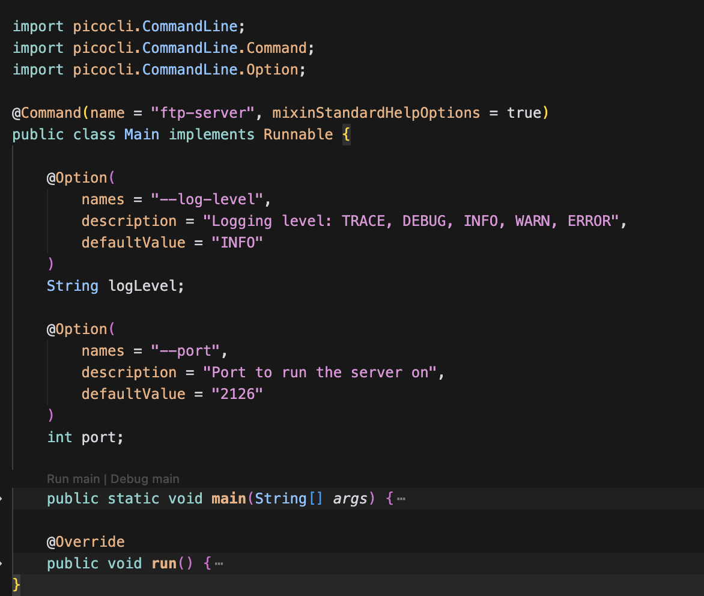

# FTP Server Implementation with Java


-blue)
<br>
**Yasmine Kaouther Boudour, Hanan Miftah Agraw, Blen Assefa Tilahun** — 14/02/26 

## Table of Contents

- [Introduction](#introduction)
- [Build and Run Instructions](#build-and-run-instructions)
  - [Prerequisites](#prerequisites)
  - [Build the Project](#build-the-project)
  - [Execute the Generated Jar File](#execute-the-generated-jar-file)
  - [Run Tests](#run-tests)
  - [Get Test Coverage Report](#get-test-coverage-report)
- [Server Configuration](#server-configuration)
- [Project Setup](#project-setup)
  - [Folder Structure](#folder-structure)
- [Supported Commands](#supported-commands)
- [Code Samples](#code-samples)
- [Test Coverage](#test-coverage)
- [UML Diagram](#uml-diagram)
- [Design Decisions](#design-decisions)
- [Task Classification](#task-classification)

## Introduction

This project implements an FTP server with a file structure starting at [ftp-root](ftp-root/) folder. The server follows most [RFC 959](http://abcdrfc.free.fr/rfc-vf/pdf/rfc959.pdf) protocols enabling a client to connect to it, list its file contents, traverse its file structure, upload new contents, download its contents, create and delete directories and files, abort connections or transfers, and more. In addition, The server supports both PASV and ACTIVE connection transfer modes from the client. The project is implemented with Java programming language and uses maven for build and test automation.


## Build and Run Instructions

### Prerequisites
- Java Development Kit (JDK) version 17
- Apache Maven version 3.x

For all the following instructions make sure you are at the project root (same level as README.md and `src/`).

### Build the Project
```shell
mvn clean package
```

### Execute the Generated Jar File
```shell
java -jar target/ftp-server-1.0.0.jar
```

### Run Tests
```shell
mvn clean test
```
### Get Test Coverage Report
Generates an html inside target/site/jacoco with the first command and open it with the second

```shell

mvn jacoco:report

open  target/site/jacoco/index.html
```
## Server Configuration

By default the server:
- Runs on port 2126
- Uses ftp_root/ as the root directory
- Supports anonymous login

You can configure runtime options using:
```shell
java -jar target/ftp-server-1.0.0.jar [--help] [--port <port>] [--log-level <TRACE|DEBUG|INFO|WARN|ERROR>]
```
Use `--help` to list all options. Example: `java -jar target/ftp-server-1.0.0.jar --port 2121 --log-level DEBUG`

## Project setup

### Folder Structure

```
├── src/
│   ├── main/
│   │   ├── java/
│   │   │   └── ftp
│   │   │       ├── Main.java                <-- Starts the Server
│   │   │       ├── core/                    <-- Yasmine's Domain
│   │   │       │   ├── FTPServer.java       <-- Socket Accept Loop
│   │   │       │   ├── ClientHandler.java   <-- Thread management
│   │   │       │   └── CommandExecutor.java <-- Command Dispatcher
│   │   │       ├── commands/                <-- Hanan's Domain
│   │   │       │   ├── FTPCommand.java      <-- Interface (The "Contract")
│   │   │       │   ├── UserCommand.java
│   │   │       │   ├── PassCommand.java
│   │   │       │   └── CwdCommand.java
│   │   │       ├── data/                    <-- Blen's Domain
│   │   │       │   ├── PassiveServer.java   <-- PASV Logic
│   │   │       │   ├── ListManager.java     <-- Directory Listing
│   │   │       │   └── TransferManager.java <-- File Upload/Download
│   │   │       ├── model/                   <-- Shared Data
│   │   │       │   └── UserSession.java     <-- Session State Tracking
│   │   │       ├── exceptions/              <-- Shared Logic
│   │   │       │   │── FTPException.java    <-- Custom Exceptions
│   │   │       │   │── AuthException.java
│   │   │       │   │── ConnectionException.java
│   │   │       │   │── FileSystemException.java
│   │   │       │   │── IllegalCommandException.java
│   │   │       │   │── SequenceException.java
│   │   │       │   │── SyntaxException.java
│   │   │       │   │── TransferException.java
│   │   │       │   │── UnavailableFileException.java
│   |   |       │   └── StorageException.java
│   │   │       ├── protocol/              
│   │   │       │   │── FTPResponse.java    <-- Response construction
│   │   │       │   └──  FTPResponseCode.java
│   │   │       └── utils/                   <-- Shared Logic
│   │   │           |── PathUtils.java      
│   |   │           └── FileLockManager.java   
│   │   └── resources/
│   │       └── log4j2.xml                    <-- Logging Config
│   └-─ test/                                 <-- Unit test files Config
│
├── ftp_root/                                 <-- Server's file storage(root directory)
├── pom.xml                                   <-- Maven Configuration
└── README.md

```

## Supported Commands

USER, PASS, QUIT  
PWD, CWD, CDUP  
PASV, PORT  
LIST  
RETR, STOR, APPEn, REST 
MKD, RMD, DELE  
RNFR, RNTO  
TYPE, REIN, ABOR  
HELP, NOOP, SYST, APPE  

## Code Samples
The main FTP server logic


Command Interface - the base of all commands


File lock management package design


Command line options configurations


Path related functionalities common utility design


## Test coverage


## UML diagram


## Design Decisions

The entire development process took 4 milestones

**Milestone 1**:  Create an extremely simple FTP server 
- First packaging structure draft and core package implementation
- Logging feature added to verify received commands and sent responses
- User session model design and FTPCommand interface implementation

_Design choices at this milestone_
- The team decided to implement mainly 4 packages  
    - [core](src/main/java/ftp/core/) > serves as the front package that does interaction with the client requests/commands
    - [commands](src/main/java/ftp/commands/) > contains the FTPCommand interface and its implemenations
    - [model](src/main/java/ftp/model/) > contains the user session model
    - [data](src/main/java/ftp/data/) > concerns with file level implementations on the [ftp-root](ftp-root/) folder 
- The team decided to include transferType attribute in the UserSession model, to handle different type transfer requests from client
- Used ExecutorService in FTPServer to handle multiple clients concurrently in their own threads

**Milestone 2**: Implementation of major commands, and Exception interface
- CommandExecutor dispatcher implementation to handle commands 
- PathUtils implementation to facilitate path-related functionality 
- More command implementations including PASV, LIST, STOR, RETR, CWD, CDUP, PWD
- First sample test implementation

_Design choice at this milestone_
- The team decided to start testing commands and implementations
- The ListManager and ListCommand had some issues when it comes to retrieving file format. 
    - FileZilla was expecting unix like structure and the implementation at the time didn't support that.
    - The team decided to do FileZilla tests in addition to unit tests with mock libraries
_passive mode architecture flow_
```
Client                    Control Connection                         Data Connection
  |                              |                                        |
  |--- PASV -------------------->|                                        |
  |                              |-- Create PassiveServer                 |
  |                              |-- Open random port                     |
  |<--- 227 Entering PASV -------|                                        |
  |                              |                                        |
  |                              |<-- Client connects --------------------|
  |--- LIST -------------------->|                                        |
  |                              |-- Accept connection                    |
  |                              |-- ListManager.sendDirectoryListing()   |
  |<-- 150 Opening data mode ----|                                        |
  |                              |<-- Directory listing sent -------------|
  |<-- 226 Transfer complete ----|                                        |
```

**Milestone 3**: Implementation of additional commands, test coverage and asking for progress review
- More command implementation after thorough review of [RFC 959](http://abcdrfc.free.fr/rfc-vf/pdf/rfc959.pdf)
- Concurrency handling with [FileLockManager.java](src/main/java/ftp/utils/FileLockManager.java)
- More unit test implementation together with the [jacoco plugin](https://mvnrepository.com/artifact/org.jacoco/jacoco-maven-plugin) for analysing test coverage  of 77 %
- Active mode transfer implementation

_Design choice at this milestone_
- The team identified an issue that occurs when more than one client is connected and sends conflicting commands (e.g. one downloads a file while another deletes it)
- The team decided to implement FileLockManager: a lock per target path so that critical actions (delete, rename, mkdir, transfer) are serialised per path

_active mode architecture flow_
```
Client                    Control Connection                         Data Connection
  |                              |                                        |
  |--- PORT -------------------->|                                        |
  |   (client IP + data port)    |-- Store address, clear PASV            |
  |<--- 200 PORT successful -----|                                        |
  |                              |                                        |
  |--- LIST -------------------->|                                        |
  |                              |-- Connect to client (address:port) --->|
  |                              |-- ListManager.sendDirectoryListing()   |
  |<-- 150 Opening data mode ----|                                        |
  |                              |<-- Directory listing sent -------------|
  |<-- 226 Transfer complete ----|                                        |
```

**Milestone 4**: code clean up, documentation
- Classify logging levels deeper to TRACE, DEBUG, INFO, WARN, ERROR
- Implement an Object for messages sent to clients
- Use [PicoCLI](https://picocli.info/) to accept CLI options: `--port` (server port), `--log-level` (TRACE, DEBUG, INFO, WARN, ERROR), and `--help`
- Implement FileLockManager to more critical sections
- Remove nested Exceptions
- Remove unnecessary comments
- Add README documentation
- Add Video demo

## Task Classification
For all four milestones each team member contributed to the codebase. In general the structure of task classification is as follows:

**Yasmine:** Project Structure, Core Package, Exceptions, some commands, video demo

**Hanan:** Commands, Test Coverage, UserSession model, File lock manager

**Blen:** Logging, Data Package, PathUtils, Documentation, some commands

And each member was responsible for testing on filezila and writing unit tests for logics that they implemented.


